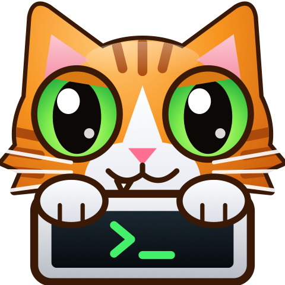

<p align="center"></p>

<h1 align="center">PadTerm</h1>
<p align="center"><b>Run Claude Code and Codex from an iPad of 2012, on iOS 6.</b><br>A native SSH + tmux terminal. The agents run on your own server; the iPad shows their real terminal UI.</p>
<p align="center">No account. No relay. No telemetry. Each agent logs in on your server with your own account.</p>

| | |
|---|---|
| **Install** | [Install guide](docs/install/README.md) for every iPad, with or without a jailbreak |
| **Tested** | ✅ iPad mini 1, iOS 6.1.3: earlier builds ran on the real device, with a real Claude session over Wi-Fi.<br>⚠️ **v0.1.0 itself has not run on a real iPad yet.** It has a new SSH library build (a security fix), a new name and new icons. It passes the Mac tests and the iOS 6 binary checks |
| **Experimental** | ⚠️ iOS 7 and later: tested only on modern UIKit through a Mac test bench. **No real iPad on these versions has run it.** Please send a [device report](../../issues/new?template=device-report.yml) |
| **Security** | [SECURITY.md](SECURITY.md): known limits, and how to report a problem |

New Claude and Codex sessions start in **auto mode**: the agent can edit files and run commands on your server without asking each time.

The same idea as [ClaudeBerry](https://github.com/0xProbabillity/claudeberry) for BlackBerry, written new for iOS 6; no code is shared with it. Design documents: [requirements](docs/business/requirements/padterm.md), [architecture](docs/architecture/designs/padterm.md).

## What it does

| Feature | Detail |
|---------|--------|
| SSH | Ed25519 key, `curve25519-sha256`, `chacha20-poly1305` / AES-GCM / AES-CTR; libssh2 (pinned main-branch commit with the 2026 security fixes, see `scripts/dep_pins.sh`) + OpenSSL 3.5.9 built for armv7 |
| Host key | Pinned as `SHA256:…`; asked on first connection; a different key stops the connection before login |
| New session | **Claude** and **Codex** rows start a new session; **Shell** opens the one shell. All run in tmux on the private socket `tmux -L padterm` |
| Continue | The server page lists the sessions from this app, newest activity first, with the name the agent gave them; the name updates by itself. A tap attaches, or resumes with `claude --resume` / `codex resume` if the agent stopped. The **Sessions** button does the same from a terminal. Swipe to delete ends the tmux session; the agent's transcript stays. The server keeps the list in `~/.padterm` |
| Lost link | Keep-alive every 30 s; reconnect after 1 s, 2 s, 4 s … 30 s; tmux keeps the agent running |
| Terminal | xterm-256color, true colour, bold/dim/italic/underline, UTF-8, wide characters (libvterm 0.3.3, patched for dim and xterm colours) |
| Characters | DejaVu Sans Mono; box lines, blocks and `⎿ ⏵ ⏺ ⎯ ⏸ ⏹ ⧉` drawn as shapes so lines join |
| Keys | Key bar (44 pt keys, five groups, optional key click): Esc, Tab, ⇧Tab, Ctrl (one shot, lit while armed), ^C, arrows, PgUp, PgDn, Enter; tap = mouse click, swipe = wheel; long press = paste |
| Look | Apple's own iOS 6 style. Light: stock silver bars and tables, as in Settings and Mail. Dark: black bars and charcoal rows, changed live with no reconnect. The gear opens settings: appearance, font size 9–24, four terminal themes (classic dark, light, amber, green), key click, keep screen on (on by default while a terminal is open) |

New Claude and Codex sessions start in their auto mode: `claude --permission-mode auto` and `codex --approve-for-me` (Codex 0.164 or newer; an older Codex rejects the flag and leaves you at a shell). An automatic reviewer checks risky actions, so this is not a full bypass. **⇧Tab** changes the mode in Claude.

A clean exit of the agent ends its tmux session. If the directory of a new session does not exist, no agent starts: the terminal shows the reason and a shell.

A swipe enters tmux scrollback (yellow counter at the top right). Keys do not reach the program there: tap **Esc** to go back.

Not in this version: password login, voice, SFTP, port forwards, several open connections.

## 1. Server setup (Linux or macOS)

```sh
# Linux (Debian/Ubuntu)                       # macOS
sudo apt install tmux openssh-server          brew install tmux    # and turn on Remote Login
```

Install the agents as the user the iPad logs in as, and **log in to both from a computer** (the sign-in
flows need a browser):

```sh
curl -fsSL https://claude.ai/install.sh | bash   # then run: claude      (follow the sign-in link)
npm install -g @openai/codex                     # then run: codex login
```

Make a key for the iPad and allow it on the server:

```sh
ssh-keygen -t ed25519 -N "" -C ipad -f ~/.ssh/id_ed25519_ipad
ssh-copy-id -i ~/.ssh/id_ed25519_ipad.pub you@your-server
ssh you@your-server ssh-keygen -lf /etc/ssh/ssh_host_ed25519_key.pub   # note the fingerprint
```

The remote command adds `/opt/homebrew/bin`, `/usr/local/bin` and `~/.local/bin` to `PATH`, so tmux, `claude`
and `codex` are found on macOS too. Your login shell must be sh, bash or zsh.

**macOS server:** macOS keeps the login keychain from SSH sessions, so a Claude login made in the Mac's own Terminal does
not work from PadTerm (`Login expired`). Log in once from an SSH session: `scripts/mini_login.sh user@host`, or `claude auth login`
in any SSH session on that Mac.

To watch the iPad's sessions from a computer: `tmux -L padterm ls`, then `tmux -L padterm attach -t '=pc-<key>'`.

## 2. Install on the iPad (USB, no root anywhere)

The iPad must accept unsigned apps through the normal install service. The test iPad (jailbroken, iOS 6.1.3) does.
On the Mac: `brew install libimobiledevice ideviceinstaller`. Connect the iPad by USB, then:

```sh
scripts/ipad_deploy.sh ios/packages/dev.padterm.app_0.1.0_iphoneos-arm.deb
scripts/ipad_install_key.sh ~/.ssh/id_ed25519_ipad my-server   # copies the key to the app's Documents
```

In the app: **+** (or **Add Server** on the first-run screen) → name `my-server` (the same name), host, port, user, directory → in the key section choose **Import file** and tap the row → **Save**. The app
deletes the copy in Documents after the Save. Select the server, tap the **Claude** row, compare the fingerprint, tap **Trust**.

Without the Mac tools, iTunes File Sharing also shows the app's Documents folder. The iPad needs Wi-Fi to reach your
server. The server must accept incoming SSH: a Mac with "Block all incoming connections" in its firewall refuses it.

### Other iPads and iOS versions

`scripts/package_all.sh` makes one set of packages in `dist/`: a fat `.ipa` for sideloading, a rootful `.deb` and a rootless `.deb`. [docs/install/README.md](docs/install/README.md) gives the route for each iPad.

**Only iOS 6.1.3 on an iPad mini 1 has run on a device.** The modern code path has run on modern UIKit through a Mac test bench (`tests/modern/run_bench.sh`), which found three bugs that iOS 6 cannot show. No modern iPad has run the app. Details: [docs/design/ios-version-support.md](docs/design/ios-version-support.md).

## 3. Build (macOS, Apple Silicon, Command Line Tools only)

```sh
# Pinned: the commits this project was last built with.
git clone --recursive https://github.com/theos/theos ~/theos && git -C ~/theos checkout 6e7b8c40e0f5f9f5b2377800dc1e42cd2560d24a
git clone https://github.com/theos/sdks /tmp/sdks && git -C /tmp/sdks checkout 0222fd5413cf4b9af096f37b4621afa2688572f7
cp -R /tmp/sdks/iPhoneOS9.3.sdk /tmp/sdks/iPhoneOS16.5.sdk ~/theos/sdks/
brew install dpkg make ldid cmake tmux
# All iOS code builds with -mno-thumb: today's linker (ld-27037) writes code pointers without the Thumb bit,
# and Thumb code then crashes on the device. scripts/check_ios_binary.py fails a build that has Thumb functions.
scripts/make_ios_sdk.sh       # SDK copy that today's linker accepts for armv7 (see the script)
scripts/build_deps.sh         # OpenSSL + libssh2 for ios-armv7 and macos-arm64
scripts/prepare_libvterm.sh   # libvterm 0.3.3 + third_party/patches/libvterm-0.3.3-pt.patch
THEOS=~/theos PATH="/opt/homebrew/opt/make/libexec/gnubin:$PATH" make -C ios clean package FINALPACKAGE=1  # clean: theos does not watch build/ios/libpadcore.a
```

## 4. Tests

```sh
scripts/run_tests.sh   # → tests/artifacts/test_results.json (+ AC/BR/EF coverage)
```

Keep the clone at a short path: tmux's socket lives under `build/`, and macOS limits a socket path to 103 characters.

| Suite | What runs |
|-------|-----------|
| unit | Shell quoting, golden remote command, colours, attributes, UTF-8, keys, paste, mouse, renderer pixels |
| profile | Profile model and store (Objective-C) on macOS |
| e2e | A private `sshd` on 127.0.0.1:2222 (no sudo), real tmux, real `claude` and `codex` (no prompt is sent) |
| ios | The `.deb`: armv7 only, all functions ARM, `LC_VERSION_MIN_IPHONEOS 6.0`, no chained fixups, no TLS variables, iOS 6 libraries and symbols only, no test code |

**On the real iPad** (USB-connected, no root): `tests/device/run_device_tests.sh` installs a `SELFTEST=1` build, runs
real SSH sessions through a relay over USB to a private `sshd` on the Mac, with real `claude` and `codex`, and takes
screenshots to `tests/artifacts/device/`. It needs Apple's iOS 6.1 developer disk image at `build/ipad/ddi/`. The Mac
drives the app through a control port, so **real finger touches and the on-screen keyboard are not tested**.
Afterwards install the release build again: `scripts/ipad_deploy.sh`. A repeated uninstall and install loop crashed SpringBoard once on the test iPad: install on top.

| Device test | What runs |
|-------------|-----------|
| `tests/device/ui_full_test.py` | Every screen in light and dark, with repeated taps, rotation and a layout audit after each step: no control may leave its container, be covered, or lie under a label |
| `tests/device/sessions_test.py` | The session flow with real Claude and Codex over USB |
| `tests/device/wifi_sessions_test.py` | The session flow with real Claude over Wi-Fi: name, rename, stop, `/exit`, resume |
| `tests/device/wifi_claude_test.py` | A note app made through the iPad in 10 messages, with stability, lag and memory numbers |
| `tests/device/first_glyph_test.py` | Draw time of the first characters that need a system font |

**Modern UIKit, no device:** `tests/modern/run_bench.sh [light|dark]` builds a Mac Catalyst copy (Command Line Tools only) and runs the full UI test with real SSH and tmux. It is not an iPad: no touch, no on-screen keyboard.

**Before a release:** `scripts/check_release.py` fails on a key, a session record, a test capture, a local path or mascot art. Words of your own (host names, addresses) go in the git-ignored `build/release_denylist.txt`. The Wi-Fi tests read your lab from `PT_WIFI_HOST`, `PT_WIFI_USER` and `PT_WIFI_IPAD`.

## Layout

```
core/      C: SSH, IO thread, terminal, keys, remote command
render/    C: CoreGraphics/CoreText grid renderer
ios/       theos app (Objective-C, iOS 6 API only); ios/selftest/ only in SELFTEST=1 test builds
tools/     ptlaunch (start an app over USB), ptmount (mount the developer image on iOS 6), make_art (icon, launch images and an art preview from the app's own drawing code)
tests/     host/ unit + profile tests, e2e/ against a local sshd, device/ on the real iPad
scripts/   build, SDK fix, test runner, binary checks, coverage
assets/    DejaVu Sans Mono fonts + licence (generated icons in assets/art are not in git)
third_party/licenses/  licence texts of the libraries; they also ship inside the app
```

## Art

Every icon is drawn by the app's own code (`ios/src/PTArt.m`, `scripts/make_art.sh`). PadTerm has one mascot: an orange tabby cat with terminal-green eyes, peeking over an old iPad. The project ships no third-party logo or mascot, and `scripts/check_ios_binary.py` fails a package that has one.

## Licences

| Part | Licence |
|------|---------|
| PadTerm | MIT ([LICENSE](LICENSE)) |
| libvterm | MIT |
| libssh2 | BSD-3-Clause |
| OpenSSL 3 | Apache-2.0 |
| DejaVu fonts | Bitstream Vera / DejaVu licence ([assets/fonts/DejaVu-LICENSE.txt](assets/fonts/DejaVu-LICENSE.txt)) |

PadTerm is not affiliated with Anthropic or OpenAI. Claude and Claude Code are trademarks of Anthropic; Codex is
a trademark of OpenAI.
