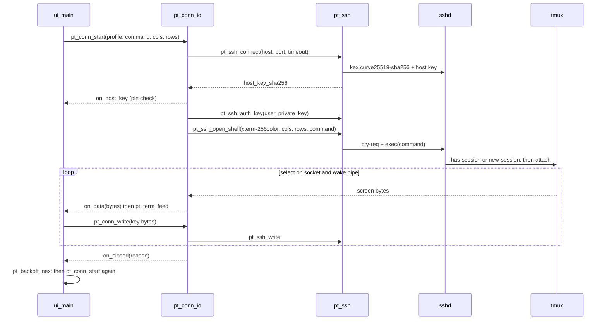

# PadTerm technical design

Requirements: [BREQ-PADTERM](../../business/requirements/padterm.md).

## Layers

| Layer | Folder | Language | Depends on | Tested on macOS |
|-------|--------|----------|------------|-----------------|
| Core | `core/` | C99 | libssh2, OpenSSL, libvterm, POSIX | Yes: unit + E2E against local `sshd` |
| Render | `render/` | C99 | CoreGraphics, CoreText | Yes: draw to bitmap, check pixels |
| iOS app | `ios/` | Objective-C (ARC) | Core, Render, UIKit (iOS 6 API only) | Build + binary checks only |

The core and the renderer have no UIKit and no Foundation, so the same files build for macOS arm64 (tests) and
iOS armv7 (app).

## Core modules

| Module | Responsibility | Use cases |
|--------|----------------|-----------|
| `pt_quote` | POSIX shell single-quote; `~/` → `"$HOME"/` | BR-LAUNCH-2, EF-LAUNCH-2 |
| `pt_launch` | Remote command for Claude / Codex / Shell over `tmux -u -L padterm` | UC-LAUNCH |
| `pt_session` | Remote scripts that record, list, start, resume and remove sessions; session name inside a terminal title | UC-SESSION |
| `pt_term` | libvterm screen: feed bytes, cells with RGB colours, cursor, size, keys, mouse, paste, replies | UC-SCREEN, UC-INPUT |
| `pt_keys` | Key bar action → libvterm key + modifier | AC-INPUT-1, AC-INPUT-2 |
| `pt_ssh` | libssh2 session: TCP connect with timeout, handshake, host key SHA256, key auth from memory, PTY + exec, read/write, resize, keep-alive | UC-CONNECT |
| `pt_conn` | One IO thread per connection: `select()` on socket + wake pipe; write queue; events to the caller; cancel pipe; backpressure (`pt_conn_ack`) | UC-CONNECT, UC-RECONNECT |
| `pt_backoff` | Reconnect delay 1 s → ×2 → max 30 s | AC-RECONNECT-2 |

## Threads

libssh2 is not safe for use from two threads on one session. Each session stays on one thread: the IO thread of `pt_conn` for a terminal, the serial queue of `PTSessionLister` for a list.
The UI thread puts bytes and resize requests in a queue under a mutex and writes one byte to a wake pipe.

| Rule | Why |
|------|-----|
| A second pipe (cancel) is in every `select` of TCP connect, handshake, auth and shell setup | `pt_conn_close` joins the IO thread on the main thread; without the cancel pipe a silent server held the UI until the setup deadline. Key presses use the wake pipe, so they never cancel a setup. Name lookup (`getaddrinfo`) cannot be cancelled. |
| The IO thread stops reading while more than 2 MiB of DATA is not acknowledged (`pt_conn_ack`) | 2 MiB = one SSH window (`LIBSSH2_CHANNEL_WINDOW_DEFAULT`). A fast server (`cat` of a big log) cannot fill the 512 MB of the iPad; SSH flow control makes the server wait. |
| The `select` write set comes only from `libssh2_session_block_directions` | With a full channel window libssh2 waits for inbound data; a socket in the write set would make `select` return at once (busy loop). |
| A loop pass more than 2 keep-alive intervals after the last one resets the dead-link timer | After an iOS suspend the silence was the app's, not the server's. |
The IO thread calls the event callback (connected, data, closed, error). The iOS layer moves each event to the
main thread, where `pt_term` and the renderer run.



## Remote command

`pt_launch_command(kind, dir)` gives one string that `sshd` runs with the user's shell (`$SHELL -c`). It uses
POSIX `sh` syntax, so bash and zsh work; fish is not supported. For `kind = claude`, `dir = ~/src/app`:

```sh
PATH="$PATH:/opt/homebrew/bin:/usr/local/bin:$HOME/.local/bin"; export PATH;
command -v tmux >/dev/null 2>&1 || { echo 'padterm: tmux not found'; exec "$SHELL" -l; };
pt_tmux() { tmux -u -L padterm "$@"; };
pt_tmux has-session -t '=claude' 2>/dev/null || {
  PT_T=tmux-256color; infocmp "$PT_T" >/dev/null 2>&1 || PT_T=xterm-256color;
  pt_tmux start-server \; set -g terminal-overrides ',xterm-256color:Tc' \
    \; set -g default-terminal "$PT_T" \; set -g status off \
    \; set -s escape-time 10 \; set -g mouse on \; set -g mode-keys emacs \; set -g focus-events on \; set-environment -g COLORTERM truecolor \; set-environment -g CLAUDE_CODE_TMUX_TRUECOLOR 1 \
    \; new-session -d -s claude -c "$HOME"/'src/app' "$SHELL" -lic 'claude --permission-mode auto; exec "$SHELL" -l'; };
exec tmux -u -L padterm attach -t '=claude'
```

The real string is one line (`tests/host/test_quote_launch.c` pins it). A shell function, not `T='tmux …'; $T`,
because zsh does not split an unquoted `$T` into words.

| Part | Reason |
|------|--------|
| `-L padterm` | Private server; the `-g` options do not change the user's own `tmux` (BR-LAUNCH-1) |
| `PT_T` | The pane terminal. Not `screen-*`: tmux then shows italics as reverse (`tty_set_italics`). `tmux-256color` needs a current terminfo, so `xterm-256color` is the fallback. |
| `terminal-overrides …:Tc` | 24-bit colour on older tmux versions; tmux 3.8 does not need it |
| `CLAUDE_CODE_TMUX_TRUECOLOR=1` | Inside tmux Claude Code otherwise sends 256 colours, and its orange `rgb(215,119,87)` becomes pale pink `(215,135,135)`. Seen on the iPad. |
| `focus-events on` | Claude Code asks for it |
| `mode-keys emacs` | Key-bar Esc must leave tmux scrollback. With `EDITOR=vi` tmux picks vi keys, where Esc does not. |
| `-u` | UTF-8 output also when the SSH session has no UTF-8 locale |
| `"$SHELL" -lic 'claude --permission-mode auto; exec "$SHELL" -l'` | Agents start in auto mode (Codex: `--approve-for-me`). The agent starts from an interactive login shell, so the user's `PATH` setup applies; after `/exit` a login shell stays in the project directory. No `send-keys`: typed text can race the shell start |
| `'=name'` | Exact session-name match (tmux does prefix match without `=`). Quoted: zsh expands a word that starts with `=` to a command path |

This table describes the Shell command. Claude and Codex use the same options through `pt_session_launch_command` (see "Sessions"), plus `set-titles`, and `$C || exec "$SHELL" -l` so that a clean exit ends the tmux session.

To watch a session from a computer: `tmux -L padterm ls`, then `tmux -L padterm attach -t '=pc-<key>'`.

## Sessions (UC-SESSION)

Each Claude or Codex session has a key (a UUID that the app makes) and a tmux session `pc-<key>` on the private socket. Shell stays one tmux session, `shell`.

| Server file | Content |
|-------------|---------|
| `~/.padterm/sessions/<key>` | Line 1 agent, line 2 directory (`pwd -P`), line 3 path of the agent's transcript (empty until found) |
| `~/.padterm/seen/<key>` | Touched at each attach; its time counts as activity |
| `~/.padterm/records/<key>` | Cached output for the list; rebuilt only when the transcript, `seen` or the Codex index is newer |
| `~/.padterm/searched/<key>` | Marks a stopped session as searched once for its transcript; removed at the next start |
| `~/.padterm/claimed` | Transcript paths of removed sessions: no other record may link them |

| Agent | New | Continue | Transcript | Name |
|-------|-----|----------|------------|------|
| Claude | `claude --session-id <key> --permission-mode auto` | `claude --resume <key> --permission-mode auto` | `~/.claude/projects/*/<key>.jsonl` | Last `custom-title`, else last `ai-title`, in the last 256 KiB |
| Codex | `codex --approve-for-me` | `codex resume <id> --approve-for-me` | While tmux runs the session: first `~/.codex/sessions/**/rollout-*.jsonl` newer than the record, with the same `cwd`, that no record and no line of `~/.padterm/claimed` holds | `thread_name` in `~/.codex/session_index.jsonl` |

Claude re-appends its title records: in 22 titled transcripts on this Mac (2026-11-04) the last one was at most 30 566 bytes from the end. A 256 KiB tail therefore finds it, and a transcript of 895 MB costs no more than a small one.

Both commands run under `sh -c`, because the user's login shell can be zsh, where a glob with no match stops the command. The agent itself still starts under `"$SHELL" -lic`.

The list follows `ls -t ~/.padterm/seen` and shows at most 50 rows. A record is written through a temp file, so a reader never sees it empty. A Codex id reaches the agent's shell only if it has letters, digits and `-` only.

`PTSessionLister` holds one SSH connection on a serial queue, only while a list is on screen, and runs the list command every 15 s. One run took 24 to 29 ms on the Mac mini with 2 sessions (2026-11-04). Its output has `S` (key, agent, time, directory), `T` (key, raw JSON record) and `R` (key, tmux runs it) lines; `PTSession` parses them. The terminal bar also takes the name from the terminal title (`set-titles on`), through `pt_session_clean_title`.

## Renderer

- Fonts: DejaVu Sans Mono and DejaVu Sans Mono Bold, in the app bundle, loaded with `CGFontCreateWithDataProvider`.
  Italic = text matrix skew. Characters that the font does not have: `CTFontCreateForString` fallback.
- Cell width = advance of `M`; cell height = ceil(ascent + descent + leading).
- Shapes instead of glyphs: box lines (light, heavy, double, rounded corners), U+2580–U+259F blocks and shades,
  and `⎿ ⏵ ⏺ ⎯ ⏸ ⏹ ⧉`.
- The caller gives a context with top-left origin (UIKit view, or a flipped bitmap in tests).

## iOS layer

| Class | File | Job |
|-------|------|-----|
| `PTSceneDelegate` | `ios/src/main.m`, arm64 pass only | iOS 13 and later: creates the window from the scene (TN3187) and hands it to `PTAppDelegate` |
| `PTAppDelegate` | `ios/src/main.m` | Window with `PTSplitController` as root; libssh2 init (abort if it fails); registers settings defaults; applies the appearance |
| `PTSplitController`, `PTNavigationController` | `ios/src/PTSplitController.m` | Home split view: server list left (always visible), chooser or empty state right. Presents the terminal (full screen) and the server form (form sheet) over it. A navigation controller forwards rotation to its top controller (iOS 6 rule) |
| `PTProfile` | `ios/src/PTProfile.m` | Server profile; `validationError` uses `pt_quote_dir` (EF-LAUNCH-2) |
| `PTProfileStore` | `ios/src/PTProfileStore.m` | `profiles.plist` + `keys/<uid>.key`, mode 0600, `NSFileProtectionComplete`; key check with `pt_ssh_key_valid`; import from `<name>.key` in the app's Documents (File Sharing), then delete that file. `initWithRoot:importDir:` lets the macOS tests use a temp folder |
| `PTProfileListController` | `ios/src/PTProfileListController.m` | Master pane: server rows, add, delete |
| `PTSession` | `ios/src/PTSession.m` | One row of the list; parses the list text line by line, sorts by last activity |
| `PTSessionLister` | `ios/src/PTSessionLister.m` | One SSH connection on a serial queue while a list shows: reads every 15 s, removes sessions |
| `PTSessionListController` | `ios/src/PTSessionListController.m` | The list, on the server page and in the terminal's Sessions popover; no reload when nothing changed or while a Delete button shows |
| `PTProfileEditController` | `ios/src/PTProfileEditController.m` | Form sheet for one profile; key paste or import (segmented control); forget the pinned host key |
| `PTLaunchController` | `ios/src/PTLaunchController.m` | Detail pane: hosts the session list, whose first group starts Claude, Codex or Shell |
| `PTEmptyController` | `ios/src/PTEmptyController.m` | Detail pane when there is no server (first run) |
| `PTTerminalController` | `ios/src/PTTerminalController.m` | Owns `pt_conn` + `pt_term`; host-key alert; reconnect timer with `pt_backoff`; keyboard and rotation resize; nav bar with LED, session name and state text, Sessions popover (a tap opens a new controller for that session) and gear; dim overlay when not connected, connect HUD; keeps the screen awake while open (setting) |
| `PTTerminalView` | `ios/src/PTTerminalView.m` | `UIView` + `UIKeyInput`; draws with the renderer; tap = mouse click, pan = wheel, long press = paste |
| `PTKeyBar` | `ios/src/PTKeyBar.m` | `inputAccessoryView`: 50 pt bar that matches the keyboard, 13 keys in five groups; key click through `UIInputViewAudioFeedback` |
| `PTSettingsController` | `ios/src/PTSettings.m` | Popover from the gear: appearance, font size, terminal theme, key click, keep screen on; writes `NSUserDefaults` |
| `PTTheme` | `ios/src/PTTheme.m` | Light or dark appearance, changed live by notification with no new connection; four terminal themes by name |
| `PTArt` | `ios/src/PTArt.m` | Custom art drawn with CoreGraphics and cached (keys, dark rows, icon gloss, LEDs, HUD). Light mode uses stock UIKit. See [ios6-nostalgia-ui.md](../../design/ios6-nostalgia-ui.md) |

### Threads in the iOS layer

- `pt_conn` events go to the main queue with `dispatch_async`; each carries the connection's generation number, and
  the controller ignores events of an older connection. The callback body runs in an `@autoreleasepool`: iOS 6
  makes no pool for a plain pthread. The controller calls `pt_conn_ack` after it feeds each DATA block.
- The host-key question (BR-CONNECT-1) blocks only the IO thread, on a semaphore that belongs to that connection.
  The alert answer or `closeConnection` signals it. `closeConnection` signals before it joins the IO thread, so a
  user who leaves the screen during the alert cannot cause a deadlock.
- Redraw: on demand, at most once per 33 ms after a change, and only the changed rows. No timer runs when the screen does not change, so an idle app sleeps.

## Build

| Target | Tool | Output |
|--------|------|--------|
| Dependencies | `scripts/build_deps.sh` | `third_party/prefix/{ios-armv7,macos-arm64}` |
| Host tests | `scripts/run_tests.sh` | `build/host/*`, `tests/artifacts/test_results.json` |
| iOS app | theos, `ios/Makefile`, SDK `iPhoneOS9.3-armv7.sdk`, target 6.0, **ARM only** (`-mno-thumb`, also for libvterm, OpenSSL, libssh2) | `ios/packages/*.deb` |
| Device test | `SELFTEST=1` build + `tests/device/` over USB | `tests/artifacts/device_results.json`, screenshots |
| All packages | `scripts/package_all.sh`, arm64 pass with `iPhoneOS16.5.sdk`, target 7.0 | `dist/`: fat `.ipa`, rootful and rootless `.deb` |
| Modern UIKit bench | `scripts/build_catalyst.sh`, `tests/modern/run_bench.sh` | `build/catalyst/PadTerm.app`, `tests/artifacts/modern/` |
| Release check | `scripts/check_release.py` | Fails on keys, session records, captures, local paths, mascots in packages |
| Binary check | `scripts/check_ios_binary.py` | Fails on Thumb functions, `LC_BUILD_VERSION`, chained fixups, TLV, min OS ≠ 6.0, test code in a release |

## What the first device run taught

| Finding on the iPad | Cause | Answer |
|---------------------|-------|--------|
| `SIGILL` at the first instruction of `main` | ld-27037 writes `LC_MAIN` without the Thumb bit | All code is ARM |
| `SIGSYS` at the first ObjC method | The same linker gap in method tables: Thumb code in ARM state decodes as `svc` | All code is ARM; `all_functions_are_arm` check |
| "The key could not be saved" | The data partition refuses protection classes (`EPERM`) | Fall back to mode 0600 and log it |
| Italic shown as reverse | tmux does this when `default-terminal` is `screen-*` | `tmux-256color`, fallback `xterm-256color` |
| A key cannot reach `/var/mobile/Library` without root | Sandbox and AFC limits | Import from Documents (File Sharing) |
